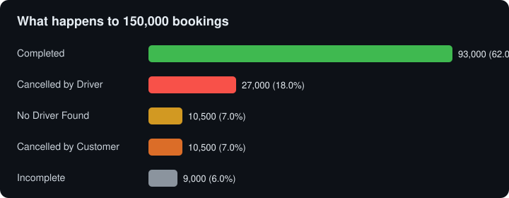
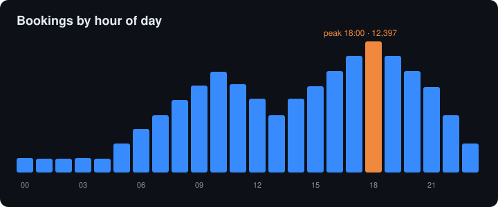
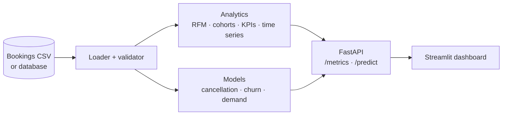

<div align="center">

# Uber NCR Ride Analytics

**Where do 150,000 ride bookings go wrong, and can we predict it?**<br>
Analytics, ML models, a REST API and a dashboard on Delhi NCR ride data (2024).


[**Findings**](#what-the-data-says) · [**Architecture**](#how-it-fits-together) · [**API**](#api) · [**Run it**](#run-it) · [**Limitations**](#limitations)

</div>

| Bookings | Completed | Lost to cancellations | Peak hour | Completed revenue |
|:---:|:---:|:---:|:---:|:---:|
| **150,000** | **62.0%** | **25.0%** (driver 18%, customer 7%) | **18:00** | **INR 47.3M** |

## What the data says

Computed directly from `DATA/ncr_ride_bookings.csv` (150,000 bookings, 1 Jan to 30 Dec 2024).

<p align="center"></p>

<p align="center"></p>

| Outcome | Bookings | Share |
|---|---|---|
| Completed | 93,000 | 62.0% |
| Cancelled by driver | 27,000 | 18.0% |
| No driver found | 10,500 | 7.0% |
| Cancelled by customer | 10,500 | 7.0% |
| Incomplete | 9,000 | 6.0% |

- **38% of bookings never complete.** Driver cancellations (18%) are almost three times customer cancellations (7%), so the biggest lever is on the supply side, not the rider side.
- **Evening peak at 18:00.** It is the single busiest hour (12,397 bookings), with 17:00 to 19:00 the three busiest.
- **Completed revenue is INR 47.3M**, about INR 508 per completed ride. Auto, Go Mini and Go Sedan are the most booked vehicle types.
- **Almost no repeat customers.** 148,788 unique customer IDs across 150,000 bookings, so nearly every customer appears once. That limits what RFM, cohort retention and churn modelling can tell you on this dataset, and the churn model should be read as a demonstration of the method, not a business-ready score.

## How it fits together



<details>
<summary><b>Repo layout</b></summary>

```
Uber-Analytics/
├── DATA/             # raw bookings CSV
├── src/
│   ├── ingestion/    # CSV/DB loader and schema validator
│   ├── analytics/    # RFM, cohort retention, descriptive KPIs, time series
│   └── ml/           # cancellation classifier, churn classifier, demand forecaster
├── api/              # FastAPI service (metrics and predictions)
├── dashboard/        # Streamlit app that calls the API
├── models/           # trained cancellation and churn models + metadata
├── tests/            # 28 test functions across 5 files
├── render.yaml       # Render deployment (API + dashboard in one service)
└── Makefile
```

</details>

<details>
<summary><b>Models</b> (cancellation, churn, demand)</summary>

| Model | Predicts | Features |
|---|---|---|
| Cancellation | Will this booking be cancelled? Returns a probability and a low / medium / high risk level | hour, weekday, weekend, peak hour, distance, booking value, vehicle type, payment method, customer ride count |
| Churn | Will a customer be inactive for the next 30 days? | days since last ride, rides in the last 30 and 60 days, average booking value and rating, preferred vehicle and payment, completion rate, average distance |
| Demand | Forecast of ride volume | time series of bookings |

</details>

## API

Start it, then open the interactive Swagger page at `http://localhost:8000/docs` and try every endpoint from the browser.

| Endpoint | Returns |
|---|---|
| `GET /metrics/summary` | headline KPIs |
| `GET /metrics/rfm-segments` | customer segment distribution |
| `GET /metrics/cancellation-funnel` | where bookings drop out |
| `GET /metrics/cohort-retention` | cohort retention table |
| `GET /metrics/revenue-trends` | revenue over time |
| `POST /predict/cancellation` | cancellation probability and risk level |
| `GET /predict/churn-risk` | customers ranked by churn risk |
| `GET /predict/demand-forecast` | demand forecast |

The API loads rides from a database when one is configured and falls back to the CSV in `DATA/` otherwise, so it runs out of the box.

**Dashboard.** Overview (KPIs and trends), Segmentation (RFM and revenue) and Predictions (cancellation, churn and demand).

## Run it

```bash
git clone https://github.com/deepbendale231/Uber-Analytics.git
cd Uber-Analytics
python3 -m venv .venv && source .venv/bin/activate
pip install -r requirements.txt

uvicorn api.main:app --reload          # API docs at http://localhost:8000/docs
streamlit run dashboard/app.py         # dashboard at http://localhost:8501
```

The dashboard reads the API address from `API_BASE_URL` (see `dashboard/.streamlit/secrets.example.toml`; the default is `http://localhost:8000`).

Tests and lint: `make test` and `make lint`.

### Deploy

`render.yaml` and `start.sh` run the API and the dashboard together in one Render web service. See [DEPLOYMENT.md](DEPLOYMENT.md) for the steps.

## Limitations

- **Model quality is not reported here.** The training code computes AUC-ROC and F1, but no evaluation results are committed yet. Treat the predictions as illustrative until they are.
- **Repeat-customer analysis is thin** for the reason above.
- **The CSV has about 1,200 repeated booking IDs** (150,000 rows, 148,767 unique), which downstream code should deduplicate.
- **Not for real operational decisions.** It is a portfolio project built on a public sample dataset.
